# Multi-Biometric Verification

Four independent encoders verify a face, an iris, or a fingerprint. Each modality keeps its own feature space. Cosine scores combine at the decision level, so one noisy sensor cannot contaminate a strong signal. This repository contains the PyTorch models, the FastAPI service, and the Next.js console.

## Results

Every number below comes from a subject-disjoint split, where the model never sees a test identity during training.

| Modality | Dataset | Metric | Result |
| --- | --- | --- | --- |
| Fingerprint | SOCOFing | EER | **0.34%** |
| Iris, near-infrared | CASIA-Interval | EER | **0.91%** |
| Face | AT&T | EER, d' | **2.91%**, 3.72 |
| Iris, visible light | UBIRIS.v2 | EER | **5.84%** |

The face model reaches a TAR of 0.95 at a FAR of 1e-2. Visible-light iris costs 6.4 times the error rate of near-infrared iris on the same architecture. Native-resolution fingerprint training lowers the error rate by 59 percent against a 224 x 224 resize.


## Architecture

Generic backbones discard the high-frequency structure that defines a biometric. A face is an oval and an iris is an annulus, so the global shape carries no identity. The discriminative signal sits in ridge bifurcations and iris crypts. This framework therefore gives each modality its own encoder and its own attention module.

Unification happens at the decision level. The encoders never exchange features.



### Pipelines

| Modality | Backbone | Input | Loss | Attention |
| --- | --- | --- | --- | --- |
| Face | IResNet50, PReLU | 112 x 112, MTCNN | AdaFace, s=32, m=0.5 | multi-task attribute head |
| Iris, near-infrared | EfficientNetV2-S | 224 x 224 square ROI | ArcFace with margin warmup | IrisAttention |
| Iris, visible light | EfficientNetV2-S | 224 x 224 square ROI | SubCenter ArcFace, K=3 | IrisAttention |
| Fingerprint | EfficientNetV2-S | native, up to 388 x 388 | AdaFace with warmup | RidgeAttention |

Every embedding has 512 dimensions and uses L2 normalization. The fusion stage applies a cosine score per modality. A quality threshold gates each score, then the weighted scores combine into one value.

### RidgeAttention

RidgeAttention has two branches. The channel branch pools the feature map, then runs two convolutions at C/16. The spatial branch applies a 7 x 7 convolution across the channel axis. The two maps multiply element-wise.

The module needs no minutiae labels. The gate aligns to the ridges on its own during training. The correlation with a ground truth ridge mask rises from 0.12 at epoch 5 to 0.81 at epoch 60.



### IrisAttention

IrisAttention combines two established blocks. The SE block pools the whole feature map and assigns one weight per channel. The ECA block compares each channel with its neighbours through a one-dimensional convolution. The module reduces no dimensions, so fine iris code survives the gate.

The same architecture gives different results under different light. Near-infrared capture gives 0.91 percent EER. Visible-light capture gives 5.84 percent EER, because off-axis gaze, lashes and specular glare corrupt the image.



### Template protection

A stolen biometric template cannot be revoked, so the stored vector must be useless on its own. The protection stage appends deterministic chaff, which doubles the vector length. A QR decomposition then projects the chaffed vector onto a random orthogonal basis.

The same key always rebuilds the same basis, so cosine similarity still works inside the protected space. The raw embedding never leaves the process.



## Project structure

```
.
├── assets/                       # animated diagrams
├── scripts/
│   ├── train.py                  # generic training loop
│   ├── train_full.py             # full multi-stage training
│   ├── train_all_datasets.py     # trains every modality in turn
│   ├── train_single_modality.py  # trains one modality
│   ├── evaluate_best_model.py    # scores a checkpoint
│   ├── evaluate_ensemble_chimeric.py
│   ├── preprocess_iris.py        # iris crop and normalization
│   ├── expand_gallery.py         # builds the enrolled gallery
│   ├── monitor_gpu.py            # prints GPU load
│   ├── setup_handover.ps1        # first time setup
│   ├── create_handover_bundle.ps1
│   └── validation_suite/
│       ├── run_all_validation.py
│       ├── validate_face.py
│       ├── validate_iris.py
│       ├── validate_fingerprint.py
│       └── validation_utils.py
├── src/
│   ├── data/
│   │   ├── datasets/             # PyTorch dataset classes
│   │   ├── preprocessing/        # alignment and normalization
│   │   └── augmentation/         # domain transforms
│   ├── evaluation/               # EER, FAR, FRR, AUC, ROC, DET
│   ├── inference/                # predictor wrapper
│   ├── models/
│   │   ├── encoders/             # iresnet, biometric encoder
│   │   ├── face/                 # adaface, trainer, config
│   │   ├── iris/                 # IrisAttention, trainer, config
│   │   ├── fingerprint/          # RidgeAttention, TTA, config
│   │   ├── ensemble/             # score fusion, template protection
│   │   ├── fusion/
│   │   └── losses/               # ArcFace, AdaFace
│   ├── training/                 # losses, schedulers
│   └── utils/                    # hardware, logging
├── webapp/
│   ├── backend/src/api/          # FastAPI, verify and identify
│   └── frontend/src/             # Next.js console
├── requirements.txt
├── start_platform.ps1
└── train_models.ps1
```

## Installation

The platform runs on Windows with PowerShell.

1. Install Python 3.12 and Node.js LTS.
2. Clone the repository.
3. Run the setup script from the repository root:

```powershell
.\scripts\setup_handover.ps1
```

The script creates a virtual environment and installs the Python and the Node packages. It takes 5 to 15 minutes.

If PowerShell blocks the script, run this command first:

```powershell
Set-ExecutionPolicy -Scope Process -ExecutionPolicy Bypass
```

## Usage

Start the backend and the frontend:

```powershell
.\start_platform.ps1
```

The backend listens on port 8000. The frontend listens on port 3000. Open `http://localhost:3000` in a browser.

To use different ports, run:

```powershell
.\start_platform.ps1 -BackendPort 8100 -FrontendPort 3100
```

Open `http://localhost:3100` instead.

The console offers two modes.

| Mode | Question | Input |
| --- | --- | --- |
| Verify, 1:1 | Is this the claimed identity? | one image, one claimed identity |
| Identify, 1:N | Who is this? | one image, the whole gallery |

The default threshold is 0.75. A score above the threshold grants access. A match for a revoked user shows a revocation notice.

## Training

Run the interactive menu:

```powershell
.\train_models.ps1
```

| Option | Action |
| --- | --- |
| 1 | Train the face model |
| 2 | Train the fingerprint model |
| 3 | Train the near-infrared iris model |
| 4 | Train the visible-light iris model |
| 5 | Run the iris pipeline |
| 6 | Run a custom sequence |
| 7 | Build the ensemble |
| 8 | Quit |

Run one option without the menu:

```powershell
.\train_models.ps1 -Option 1
```

To set the number of epochs and the batch size, run:

```powershell
.\train_models.ps1 -Option 1 -Epochs 60 -BatchSize 32
```

Checkpoints appear in `outputs/`. Training logs appear in `logs/`.

A GPU shortens training from hours to minutes. The code also runs on a CPU, at a much lower speed.

## Evaluation

Run every validator:

```powershell
python scripts\validation_suite\run_all_validation.py
```

Run one validator:

```powershell
python scripts\validation_suite\validate_fingerprint.py
```

Test the ensemble against chimeric pairs:

```powershell
python scripts\evaluate_ensemble_chimeric.py
```

The chimeric test pairs a genuine template with a constructed impostor. It detects whether the ensemble scores high because it recognizes the person, or because it memorized the training set.

## Reference

This repository implements the manuscript *Multi-Biometric Verification via Independent Modality-Specific Architectures and Decision-Level Fusion*.

The method builds on the following work:

- ArcFace, Deng et al., CVPR 2019.
- AdaFace, Kim et al., CVPR 2022.
- Squeeze-and-Excitation Networks, Hu et al., CVPR 2018.
- Efficient Channel Attention, Wang et al., CVPR 2020.
- EfficientNetV2, Tan and Guo, ICML 2021.
